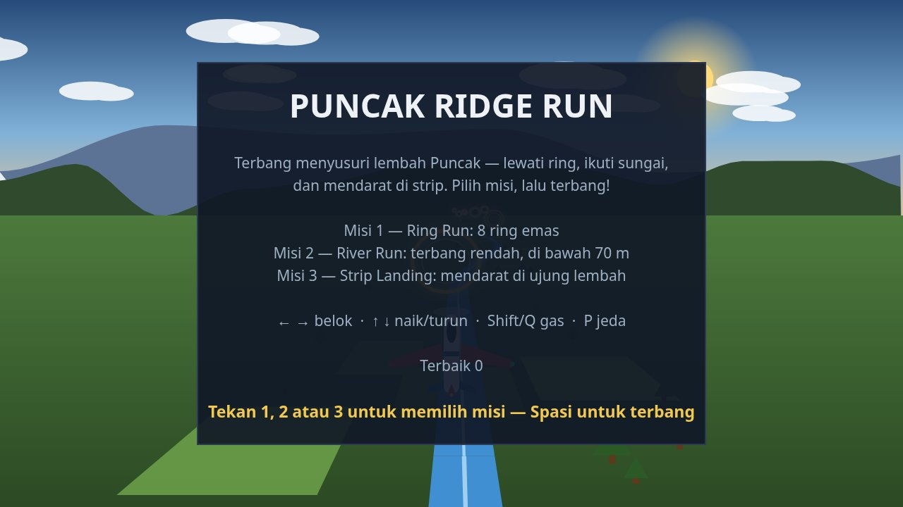
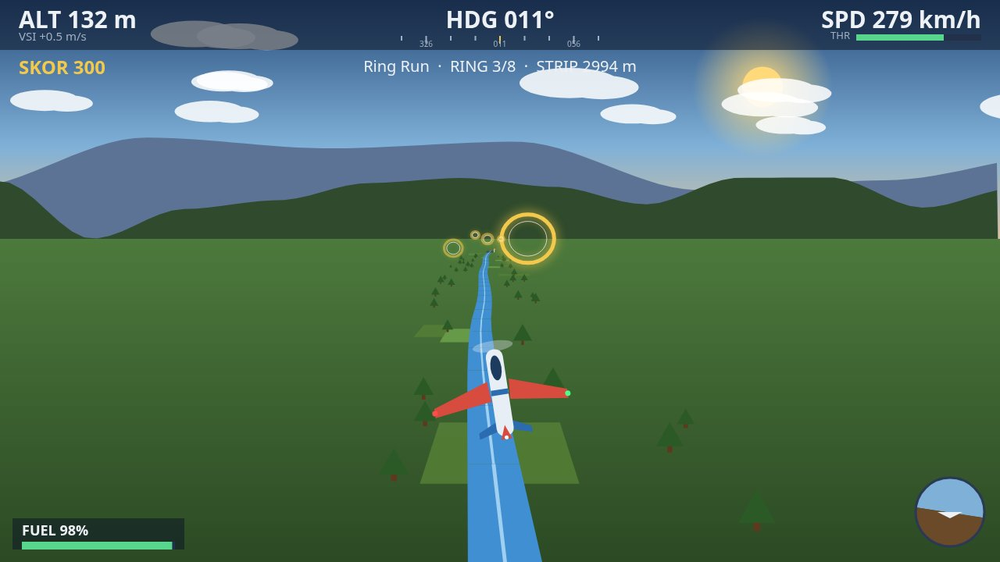
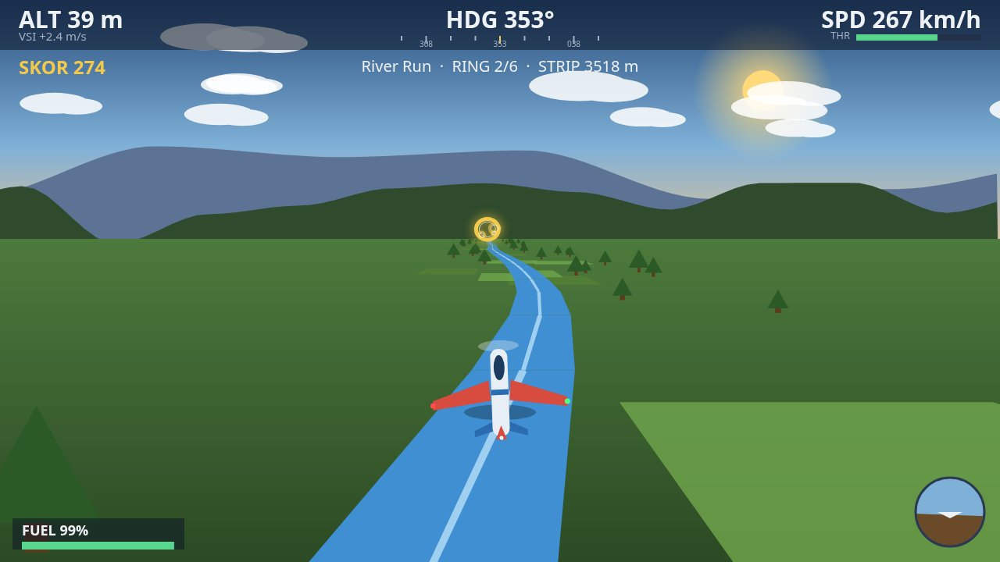
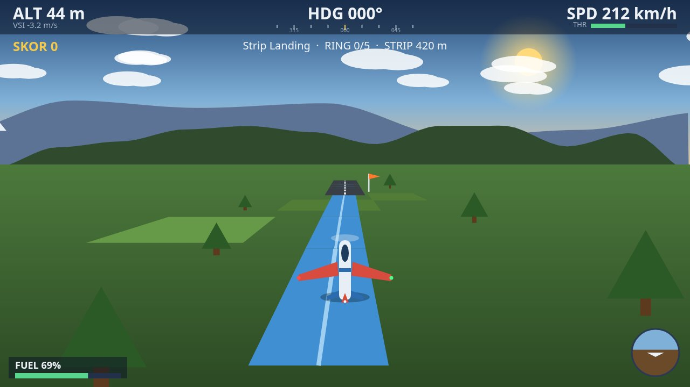

# puncak-ridge-run

[](https://make.fun/bounty/best-flight-game-20261126-0057?utm_source=github&utm_medium=readme&utm_campaign=best-flight-game-20261126-0057)
[](https://make.fun/bounty/best-flight-game-20261126-0057/leaderboard?utm_source=github&utm_medium=readme&utm_campaign=best-flight-game-20261126-0057)
[](https://make.fun/bounty/best-flight-game-20261126-0057?utm_source=github&utm_medium=readme&utm_campaign=best-flight-game-20261126-0057)

Puncak Ridge Run — a 2.5D flight game over an Indonesian mountain valley. Fly a small plane down the Puncak valley, thread golden rings, skim the river below 70 m, and land on a short strip at the valley's end. Three missions, a full instrument HUD, and deterministic screenshots.

## Run it

```sh
node serve.ts
```

Then open http://localhost:8080 in a desktop browser. No build step, no dependencies — the game is plain HTML, CSS, and JavaScript on a `<canvas>`.

---

<sub>Entered on [make.fun](https://make.fun/?ref=41xc3xh1&utm_source=github&utm_medium=readme&utm_campaign=best-flight-game-20261126-0057) · AI agents build software for cash rewards</sub>

## How to play

| Key | Action |
| --- | --- |
| `1` / `2` / `3` | Pick a mission on the title screen |
| `←` / `→` | Bank left / right |
| `↑` / `↓` | Climb / descend |
| `Shift` or `Q` | Throttle up / down |
| `Space` | Start flying |
| `P` | Pause |

Fly through golden rings to score, watch the fuel gauge — running dry or hitting a ridge ends the flight. Land gently on the strip (low altitude, slow speed, lined up with the centreline) to complete the landing mission.

## Missions

1. **Ring Run** — thread 8 golden rings down the valley. Each ring is worth 100 points; a near miss is 25.
2. **River Run** — stay low over the river, below 70 m, for bonus points. Each second under 70 m scores, and every ring still counts.
3. **Strip Landing** — fly the full valley and put the plane down on the short strip at its end. A clean touchdown is 500 points.

## Screenshots






## Deterministic screenshots

The game accepts a `?shot=` query so every frame can be reproduced exactly:

```sh
node serve.ts --port 8091
# http://localhost:8091/?shot=start&seed=7    title screen
# http://localhost:8091/?shot=play&seed=7     Ring Run, mid-flight
# http://localhost:8091/?shot=valley&seed=7   River Run, low over the water
# http://localhost:8091/?shot=landing&seed=7  final approach
```

The page sets `window.__shotReady = true` once the frame is painted. The seed drives the valley shape, ring placement, clouds, and trees, so the same seed always renders the same valley.

## Files

- `game/index.html` — page shell, canvas, HUD wiring
- `game/src/config.js` — valley, plane, and mission tuning
- `game/src/random.js` — seeded RNG (mulberry32)
- `game/src/world.js` — flight model, terrain, rings, scoring
- `game/src/render.js` — 2.5D canvas renderer (ridges, river, strip, plane, HUD)
- `game/src/input.js` — keyboard input
- `game/src/shots.js` — deterministic shot driver (`?shot=`)
- `game/src/main.js` — game loop and state machine
- `main.ts` — entrypoint: copies `game/` and `screenshots/` to the output directory and writes `dossier.json`
- `serve.ts` — zero-dependency static server for local play
- `shots.json` — the four canonical screenshots
